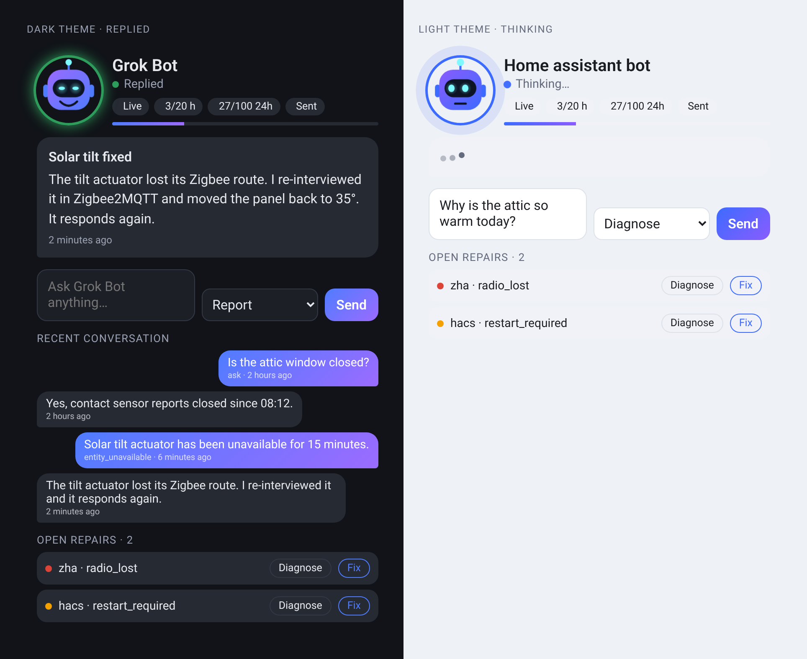

# Grok Bot for Home Assistant

[](https://hacs.xyz/)
[](https://www.home-assistant.io/)
[](https://discord.gg/qaHPTTKHae)
[](https://liberapay.com/Malosaaa/donate)

Let Home Assistant talk to your **Grok Bot** assistant. Home Assistant sends tasks, questions, events and problems to a Grok Bot **routine webhook**. Grok Bot then acts in Home Assistant through its own Home Assistant connector and answers back with the `grok_bot.reply` action.



> **Every message Home Assistant sends to the webhook costs Grok Bot usage.** Nothing is sent automatically until you allow it, and a send budget (20 per hour, 100 per 24 hours by default) drops anything over the limit instead of queueing it.

> **Status: private test version (0.1.0).** There is no public Grok Bot API. The only transport is an HTTPS POST to a routine webhook, so replies are asynchronous: they take seconds to minutes, not milliseconds.

## Features

* ✅ **UI setup** with a test ping, reauthentication and reconfigure flows.
* ✅ **Simple mode** with presets for beginners: *Ask only*, *Errors only*, *Errors + repairs, diagnose*, or *Custom*.
* ✅ **Advanced mode** with every option: allowlists, per-entity filters, Jinja message templates, a per-trigger action mode, quiet hours, budgets, debounce, a payload size limit and an attribute toggle.
* ✅ **Actions:** `grok_bot.ask`, `send_event`, `diagnose`, `fix_issue`, `health_report`, `ping` (all return the delivery status), and `grok_bot.reply` for Grok Bot's answers.
* ✅ **Problem watchers** (opt-in): logged errors and warnings, repair issues, entities that stay unavailable, failed automations and scripts, and integration setup failures. You choose per watcher whether Grok Bot only **reports**, **diagnoses**, or may **diagnose and fix**.
* ✅ **Budget guard:** hourly and 24-hour limits, a **Pause sending** switch, counter sensors, and `grok_bot_dropped` events. Nothing is queued and nothing is retried automatically.
* ✅ **Optional entities:** a notify entity (`notify.send_message` to Grok Bot) and an **Assist conversation agent**.
* ✅ **Replies:** a *Last reply* sensor with recent history, a `grok_bot_reply` event, and delivery to an `input_text`, a notify entity or service, or a persistent notification.
* ✅ **Access through HA-MCP (recommended):** Grok Bot answers and acts in Home Assistant through the [HA-MCP](https://github.com/homeassistant-ai/ha-mcp) connector you add in the Grok Bot app. Core MCP Server works as a fallback; the integration's own token-protected access webhook is an Advanced alternative.
* ✅ **Guided onboarding:** setup detects HA-MCP (then core MCP Server), says *Install HA-MCP first* when it's missing, and otherwise shows a ready-to-paste **setup prompt** that connects your Grok Bot.
* ✅ **Trusted access (opt-in, Advanced):** for repairs that need YAML edits or a restart. Backups before every edit, a config check before every restart, a 30-minute window that switches itself off, and a notification for every action.
* ✅ **"Awaiting reply" never sticks:** a reply timeout (10 min) marks requests *Replied in Grok Bot app*, and a *Mark replies handled* button clears them at once.
* ✅ **Dashboard card** `custom:grok-bot-card`: an animated bot avatar (idle, thinking, success, error and paused states), an ask box, the last reply, the recent conversation, budget chips, and Diagnose/Fix buttons for open repairs. It comes with a visual editor, follows the dark or light theme, and accepts a custom avatar image.
* ✅ **Blueprints:** threshold alert, nightly health report, and replies pushed to your phone.
* ✅ Diagnostics with every secret redacted, plus English and Dutch translations.

## Installation

### Method 1: Marketplace (Home Assistant 2026.11 and newer, recommended)

[](https://my.home-assistant.io/redirect/marketplace_repository/?owner=DonTranQuiL&repository=grok-bot-ha&category=integration)

1. In Home Assistant, go to **Settings > Marketplace** and search for **Grok Bot** (or use the button above).
2. Open it and select **Install**. The setup starts right away, no restart needed.

> **Not in the Marketplace catalog yet?** Grok Bot is not in the HACS default list yet, so it does not show up in the Marketplace search. Until it is, select **Add from link** in the upper-right corner of the Marketplace, enter `https://github.com/DonTranQuiL/grok-bot-ha`, select **Add**, then open Grok Bot and select **Install**. (While this repository is private, this only works with a GitHub token that can read it. Use Method 3 instead.)

### Method 2: HACS (Home Assistant before 2026.11)

1. In HACS, open the three-dot menu and select **Custom repositories**.
2. Add `https://github.com/DonTranQuiL/grok-bot-ha` with the category **Integration**.
3. Install **Grok Bot**, then restart Home Assistant.

### Method 3: Manual installation

1. Copy the `custom_components/grok_bot` folder (or unzip `grok_bot.zip`) into `config/custom_components/`, so you end up with `config/custom_components/grok_bot/manifest.json`.
2. Restart Home Assistant.

---

## Beginner quickstart

1. **Create the webhook in Grok Bot.** In the Grok Bot app, create (or open) a routine that is triggered by a **webhook**. Copy two values: the **Webhook URL** and the **Authorization header** value.
2. **Add the integration.** Go to **Settings > Devices & services > Add integration > Grok Bot**. Paste the URL and the header value exactly as shown (`Bearer …`; a pasted `Authorization:` prefix is removed automatically). Leave **Send a test ping** on to check that it works. This costs one Grok Bot run.
3. **Connect Grok Bot back to Home Assistant (Access step).** Grok Bot needs an MCP connector to answer in HA, update the sensors and fix things:
   * **HA-MCP not installed?** The step says **Install HA-MCP first**: [install HA-MCP](https://my.home-assistant.io/redirect/hacs_repository/?owner=homeassistant-ai&repository=ha-mcp&category=integration) from HACS/the Marketplace, restart, [add the HA-MCP integration](https://my.home-assistant.io/redirect/config_flow_start/?domain=ha_mcp_tools) and its server entry. You can finish setup now (reply-only) and come back via **Configure > Access**; it re-detects HA-MCP.
   * **HA-MCP installed?** Setup shows **Connect it in Grok Bot** with a prompt filled in with your HA name, its HA-MCP URL and your routine webhook. Paste it into your Grok Bot. Grok Bot then shows a **one-time sign-in card** for the new connector: you log in on your own Home Assistant page (so your password never reaches Grok Bot) and allow access. Until Grok Bot answers *Connected*, a **Grok Bot not connected yet** repair stays open. The **Show Grok Bot setup prompt** button shows the prompt again.
   * **Prefer core?** [Set up MCP Server](https://my.home-assistant.io/redirect/config_flow_start/?domain=mcp_server) and add `https://<your-external-or-nabu-casa-url>/api/mcp` as a connector (OAuth or a long-lived token). The LLM API you choose there (Assist = only exposed entities) decides what Grok Bot can touch.
   * The URL must be reachable from the internet (Nabu Casa or your own external URL).
4. **Pick a preset:**
   | Preset | What gets sent automatically |
   | --- | --- |
   | **Ask only** (default) | Nothing. Only your own actions, buttons and the card. |
   | **Errors only** | Logged errors, failed automations or scripts, and integration setup failures (*report*). |
   | **Errors + repairs, diagnose** | The above plus new repair issues. Grok Bot investigates each one (*diagnose*). |
   | **Custom** | Opens Advanced mode. |
5. **Add the card.** Edit a dashboard, select **Add card**, and choose **Grok Bot** (or use `type: custom:grok-bot-card`).
6. **Ask something** in the card, or call the action from a script:
   ```yaml
   action: grok_bot.ask
   data:
     message: "The solar tilt looks stuck, can you check it?"
     context_entities: [cover.solar_tilt]
     action_mode: diagnose
     reply_to: persistent_notification
   ```
7. The answer appears in the card and in `sensor.grok_bot_last_reply`. It is also sent to `reply_to`.

To stop all sending at once, turn on **switch.grok_bot_pause_sending**.

### The setup prompt

Shown in the *Connect it in Grok Bot* step and by the **Show Grok Bot setup prompt** button (Dutch when Home Assistant's language is Dutch). It never contains your Authorization header or any token.

<details><summary>English</summary>

```text
Hi Grok Bot, please connect my Home Assistant "<your HA name>" to you.

1. Connect it: add Home Assistant as a connector using HA-MCP (homeassistant-ai/ha-mcp). MCP URL: https://<your-external-or-nabu-casa-url>/api/webhook/<HA-MCP webhook id>
   (copy the exact remote URL from HA-MCP > Configure in Home Assistant if this one is a placeholder).
   Show me the one-time connector sign-in card: I log in on my own Home Assistant page, so my password never reaches you; the access token can be revoked any time in Home Assistant under Profile > Security.
2. Create or update a webhook routine for the Grok Bot Home Assistant integration. Its webhook URL is: <your Grok Bot routine webhook URL>
   Each POST carries a JSON payload with schema, type (ask, event, state, issue, log, health_report, ping, ...), message, conversation_id, action_mode, allow_fix, context and an access block.
3. Rules for that routine:
   - Respect action_mode: report = just summarise; diagnose = investigate read-only; fix = only when allow_fix is true, and only safe, reversible fixes (reload an integration, re-enable an entity, dismiss a fixed repair).
   - Never delete integrations, devices or entities. Never restart Home Assistant Core and never edit configuration files, unless the payload's access block has trusted: true:
     - allow_yaml_edit: true lets you edit configuration.yaml, automations.yaml, scripts.yaml, scenes.yaml or files under packages/ (never secrets.yaml, .storage or custom_components). Always call grok_bot.prepare_change with the file path first and keep the returned backup_path; if anything goes wrong call grok_bot.restore_backup with it.
     - allow_restart: true lets you restart, but only through grok_bot.safe_restart (it checks the configuration first and returns the errors instead of restarting when it is invalid).
   - Always answer through the grok_bot.reply action on this Home Assistant (HA-MCP connector "<your HA name>") with the payload's conversation_id, so the integration's sensors update.
   - Stay quiet in our chat for routine successes; only message me when something failed or needs my decision.
4. Confirm it works: call grok_bot.reply with message "Connected" (no conversation_id needed).
```
</details>

<details><summary>Nederlands</summary>

```text
Hoi Grok Bot, koppel alsjeblieft mijn Home Assistant "<your HA name>" aan jou.

1. Koppelen: voeg Home Assistant toe als connector via HA-MCP (homeassistant-ai/ha-mcp). MCP-URL: https://<your-external-or-nabu-casa-url>/api/webhook/<HA-MCP webhook id>
   (kopieer de exacte externe URL uit HA-MCP > Configureren in Home Assistant als dit een voorbeeld is).
   Laat me de eenmalige aanmeldkaart van de connector zien: ik log in op de pagina van mijn eigen Home Assistant, dus mijn wachtwoord komt nooit bij jou; het toegangstoken kan ik altijd intrekken in Home Assistant onder Profiel > Beveiliging.
2. Maak of werk een webhook-routine bij voor de Grok Bot Home Assistant-integratie. De webhook-URL is: <your Grok Bot routine webhook URL>
   Elke POST bevat JSON met schema, type (ask, event, state, issue, log, health_report, ping, ...), message, conversation_id, action_mode, allow_fix, context en een access-blok.
3. Regels voor die routine:
   - Volg action_mode: report = alleen samenvatten; diagnose = alleen-lezen onderzoeken; fix = alleen als allow_fix true is, en alleen veilige, omkeerbare oplossingen (integratie herladen, entiteit weer inschakelen, opgeloste reparatie negeren).
   - Verwijder nooit integraties, apparaten of entiteiten. Herstart nooit Home Assistant Core en bewerk nooit configuratiebestanden, behalve als het access-blok trusted: true bevat:
     - allow_yaml_edit: true staat bewerken toe van configuration.yaml, automations.yaml, scripts.yaml, scenes.yaml of bestanden onder packages/ (nooit secrets.yaml, .storage of custom_components). Roep altijd eerst grok_bot.prepare_change aan met het bestandspad en bewaar het teruggegeven backup_path; gaat er iets mis, roep dan grok_bot.restore_backup aan met dat pad.
     - allow_restart: true staat herstarten toe, maar alleen via grok_bot.safe_restart (die controleert eerst de configuratie en geeft de fouten terug in plaats van te herstarten als die ongeldig is).
   - Antwoord altijd via de actie grok_bot.reply op deze Home Assistant (HA-MCP-connector "<your HA name>") met de conversation_id uit het bericht, zodat de sensoren van de integratie bijwerken.
   - Blijf stil in onze chat bij routinematige successen; stuur me alleen een bericht als iets mislukt of mijn beslissing nodig is.
4. Bevestig dat het werkt: roep grok_bot.reply aan met het bericht "Connected" (zonder conversation_id).
```
</details>

### "Awaiting reply"

Every send that expects an answer adds one to `sensor.grok_bot_awaiting_reply`. It goes back down when:
* Grok Bot calls `grok_bot.reply` with the `conversation_id` (through HA-MCP this happens right away);
* the **reply timeout** passes (Configure > Access, default 10 minutes, 0 = never): the request counts as answered in the Grok Bot app and *Last status* shows **Replied in Grok Bot app**;
* you press **Mark replies handled**.

---

## Power user reference

### Options (Settings > Devices & services > Grok Bot > Configure)

| Menu | Options |
| --- | --- |
| **Preset** | Simple presets (see above). *Custom* switches to Advanced mode. |
| **Features** | Notify entity, Assist agent, and attaching entity attributes (all **off** by default except attributes). |
| **Access** | Re-detects HA-MCP / MCP Server. Access method (`mcp` default, `webhook`, `none`), access webhook level (reply, read, control, fix), reply timeout. Advanced: allowed webhook actions, domains and entities, only-while-a-request-is-open, session length, notify on every action, max response size. |
| **Connect it in Grok Bot** | Only with HA-MCP installed: the setup prompt again. |
| **Budget** | Max sends per hour (20) and per 24 h (100). Advanced only: minimum interval per entity or event (300 s), quiet hours (drop automatic sends), payload size limit (16 kB). |
| **State and event forwarding** | Allowlisted entities and event types, an action mode for each, and whether to ignore unavailable/unknown. `state_changed`, `call_service` and other high-volume or loop-prone events, and every `grok_bot_*` event, are blocked. |
| **Per-entity filters** | Per entity: *only when the new state is one of …*, *use attribute X instead of the state*, *above/below* thresholds (these fire on **crossing** into the range, not on every change), and a minimum interval. |
| **Problem watchers** | **Logs**: minimum level, all/allowlist/denylist of loggers, grouping identical errors for N seconds (the repeat count is sent with the next one), action mode. **Repairs**: new issues, action mode. **Unavailable**: entities and minutes. **Automations/scripts**: errors, action mode. **Setup**: integrations entering setup error or retry, action mode. |
| **Message templates** | Jinja templates for the `message` field of state, event and problem sends. Variables are `entity_id`, `from_state`, `to_state`, `event_type`, `event_data`, `kind` and `issue`. |

**Action modes:** `report` (just tell me), `diagnose` (investigate and reply, change nothing), `fix` (diagnose and try **safe, reversible** fixes such as reloading a config entry or retrying; the payload sets `allow_fix: true`).

### Budget rules

* Every POST counts. That includes manual actions, buttons, the card, notify and Assist.
* Over the limit, the message is **dropped** (`grok_bot_dropped` event, *Dropped total* sensor). It is never queued.
* Manual actions can set `bypass_budget: true`. They are still counted, and the pause switch still applies.
* Automatic sends also respect quiet hours and the per-entity or per-event minimum interval.
* Nothing is retried automatically. After an authorization failure (401/403), Home Assistant asks you to reauthenticate.

### Actions

| Action | Fields | Response |
| --- | --- | --- |
| `grok_bot.ask` | `message`, `action_mode`, `data`, `context_entities`, `reply_to`, `conversation_id`, `notify_user`, `bypass_budget`, `config_entry_id` | delivery status |
| `grok_bot.send_event` | `event_type`, `message`, `data`, `action_mode` + common fields | delivery status |
| `grok_bot.diagnose` | `message`, `issue_id`, `issue_domain`, `target_config_entry_id` + common | delivery status |
| `grok_bot.fix_issue` | same as diagnose (`allow_fix: true`) | delivery status |
| `grok_bot.health_report` | `action_mode` + common. Sends open repairs, failed integrations, unavailable entities and recent errors. | delivery status |
| `grok_bot.ping` | `bypass_budget` | delivery status |
| `grok_bot.reply` | `message`, `conversation_id`, `title`, `reply_to`, `data` (used by Grok Bot) | – |
| `grok_bot.rotate_token` | `config_entry_id` | – |
| `grok_bot.prepare_change` | `path` (trusted, admin only) | `{"path", "backup_path"}` |
| `grok_bot.restore_backup` | `backup_path` (trusted, admin only) | `{"path", "restored_from"}` |
| `grok_bot.safe_restart` | – (trusted + restarts allowed, admin only) | `{"valid", "restarting", "errors"}` |

The delivery status looks like this: `{"status": "sent" | "failed" | "auth_failed" | "dropped_budget" | "dropped_paused" | "dropped_quiet_hours" | "dropped_too_large", "conversation_id": "…", "http_status": 200, "sends_last_hour": 3, "sends_last_24h": 27, "remaining_last_hour": 17, "remaining_last_24h": 73}`.

`reply_to` accepts an `input_text.*` entity (cut to its max length), a `notify.*` entity, a legacy `notify.<service>`, or `persistent_notification`. A reply can never be routed back to Grok Bot's own notify entity.

### Events

| Event | When |
| --- | --- |
| `grok_bot_sent` | A message was accepted by the webhook. |
| `grok_bot_failed` | The webhook was unreachable or returned an error. |
| `grok_bot_dropped` | Dropped. `reason` is `dropped_budget`, `dropped_paused`, `dropped_quiet_hours`, `dropped_cooldown` or `dropped_too_large`. |
| `grok_bot_reply` | Grok Bot answered (`message`, `title`, `conversation_id`, `reply_to`, `data`). |

### Entities

`sensor.grok_bot_last_reply` (with `history`), `last_status`, `last_sent`, `sends_last_hour` and `sends_last_24_hours` (with `limit`/`remaining`), `last_grok_bot_action` (access webhook audit), plus the diagnostic sensors `sent_total`, `failed_total`, `dropped_total`, `awaiting_reply`, `access_method` (`ha_mcp`, `mcp_server`, `webhook` or `none`, with the connector URL hint) and `access_webhook_url`. There is also `switch.grok_bot_pause_sending`, the buttons *Send test ping*, *Send health report*, *Fix open repairs*, *Reset budget counters*, *Mark replies handled*, *Show Grok Bot setup prompt* and *Rotate access token*, `switch.grok_bot_trusted_access` (only when Trusted access is enabled), and, when enabled, `notify.grok_bot` and `conversation.grok_bot`.

**Repairs:** *Install HA-MCP so Grok Bot can answer* (access method `mcp` but no MCP server found) and *Grok Bot not connected yet* (HA-MCP installed, no `grok_bot.reply` received yet). Both clear themselves.

**Assist:** pick *Grok Bot* as the conversation agent of a voice assistant. Assist answers right away with *"Sent to Grok Bot. I'll answer shortly."* The real answer arrives later in the reply sensor, the card and the `grok_bot_reply` event, with the same `conversation_id`.

### Payload schema (what the webhook receives)

```json
{
  "schema": 1,
  "type": "ask | custom_event | notify | conversation | diagnose | fix_issue | health_report | ping | state_changed | event | log_error | automation_error | setup_error | setup_failed | repair_issue | entity_unavailable",
  "message": "Human-readable text (template output when configured)",
  "source": "service | assist | <entity_id> | <event_type> | <logger>",
  "context": [{"entity_id": "sensor.attic", "state": "31.2", "name": "Attic", "last_changed": "…", "attributes": {}}],
  "reply_to": "input_text.grok_answer",
  "conversation_id": "8f3c…",
  "notify_user": false,
  "action_mode": "report | diagnose | fix",
  "allow_fix": false,
  "data": {"…": "type-specific details: issue, event_data, logger, traceback, repeats_suppressed, …"},
  "timestamp": "2026-11-13T08:40:00+00:00",
  "ha_instance": {"name": "Home", "version": "2026.11.0", "integration_version": "0.1.2", "config_entry_id": "…", "time_zone": "Europe/Amsterdam"},
  "reply_with": {"service": "grok_bot.reply", "data": {"config_entry_id": "…", "conversation_id": "8f3c…", "message": "<your answer>"}},
  "access": {"method": "mcp | webhook | none", "configured_method": "mcp", "mcp_ready": true, "trusted": true, "allow_yaml_edit": true, "allow_restart": false, "trusted_until": "…", "mcp_provider": "ha_mcp | mcp_server | null", "connector_url_hint": "https://…/api/webhook/<HA-MCP webhook id>", "ha_instance": {"name": "Home", "external_url": "https://…", "config_entry_id": "…"}},
  "callback": {"protocol": 1, "url": "https://…/api/webhook/…", "token": "…", "token_header": "X-Grok-Bot-Token", "access_level": "reply", "allowed_actions": ["reply"], "expires": "…", "conversation_id": "8f3c…"},
  "truncated": true
}
```

`trusted`, `allow_yaml_edit`, `allow_restart` and `trusted_until` only appear for fix requests (`action_mode: fix`, `allow_fix: true`) while Trusted access is active. `access.method` is the path that works right now (`none` when the configured MCP server isn't installed or the access webhook has no external URL). `callback` is only present with the access webhook method. `truncated` only appears when the payload had to be shrunk to fit the size limit. The integration first drops attributes, then large detail fields, then shortens the message.

**Telling Grok Bot what to do.** Put this in the routine's instructions: *"Handle the Home Assistant payload. Respect `action_mode`: for `report`, only summarise; for `diagnose`, investigate with the Home Assistant connector without changing anything; for `fix`, only perform safe, reversible fixes (reload a config entry, retry, toggle back). Always answer by calling `grok_bot.reply` with the given `conversation_id`. Message me only when `notify_user` is true or something failed."*

### Access webhook (Advanced alternative)

For an instance where no MCP connector is possible, set **Configure > Access > Access method** to *Access webhook*. Each payload then carries a `callback` block: Grok Bot POSTs `{"conversation_id": "…", "actions": [{"type": "reply", "message": "…"}, {"type": "get_states", "domains": ["light"]}]}` to `callback.url` with the `X-Grok-Bot-Token` header. The URL is a Nabu Casa cloudhook when available, otherwise your external URL.

| Level | Actions |
| --- | --- |
| Reply only (default) | `reply` |
| Read | + `get_states`, `get_history`, `list_repairs`, `get_logs`, `list_entries` |
| Control | + `call_service` (optionally limited to domains/entities) |
| Fix | + `reload_entry`, `ignore_repair`, `enable_entity` |

Restarting or stopping Home Assistant, Supervisor/host, shell and Python script actions, recorder purges, update installs and anything in `grok_bot` are always blocked. By default calls only work while a request is open (15 min). Every call is audited in *Last Grok Bot action* and a `grok_bot_action` event; **Rotate access token** invalidates the token immediately. The full protocol is in [docs/callback_protocol.md](docs/callback_protocol.md).

### Trusted access (opt-in, risky)

Some repairs can only be fixed by editing YAML and restarting, for example a deprecated `http:` block. Over the normal paths Grok Bot never does that. **Trusted access** allows it, step by step:

1. **Configure → Advanced mode → Access:** turn on *Trusted access* 🚩 and tick *"I understand Grok Bot may edit configuration files and restart Home Assistant"* (required). Choose *Allow YAML edits* and *Allow restarts* separately, and keep the *Trusted window* on (30 minutes by default).
2. A switch **Trusted access** appears. Turn it on when you want Grok Bot to work on such a repair. With the window on, it switches itself off after 30 minutes and after every restart.
3. Press **Fix open repairs** (or any `fix` request). Only then does the payload carry `access.trusted: true` with `allow_yaml_edit` and `allow_restart`.
4. Grok Bot must call `grok_bot.prepare_change` before each edit. That copies the file to `/config/.grok_bot_backups/<file>.<timestamp>.bak` and returns the backup path. It edits the file through its HA-MCP connector, then calls `grok_bot.safe_restart`, which runs a full configuration check and **only restarts when the config is valid**. Otherwise it returns the errors and Grok Bot can call `grok_bot.restore_backup`.

Allowed files: `configuration.yaml`, `automations.yaml`, `scripts.yaml`, `scenes.yaml` and `*.yaml` under `packages/`. Never `secrets.yaml`, `.storage`, `custom_components` or anything outside `/config`. The three services are admin-only and refuse to run unless Trusted access is active. Every trusted action (switch on/off, backup, restore, restart, denials) goes to the *Last Grok Bot action* audit sensor, the `grok_bot_action` event and a persistent notification. What Grok Bot can actually write is still limited by HA-MCP's own file allowlist.

### Card options

```yaml
type: custom:grok-bot-card
title: Grok Bot            # optional
avatar_url: /local/me.png  # optional: your own picture instead of the animated bot
config_entry_id: …         # optional, only with several Grok Bot entries
show_chips: true
show_ask: true
show_history: true
show_issues: true
max_history: 6
max_issues: 4
default_mode: report       # report | diagnose | fix
```

### Blueprints

[](https://my.home-assistant.io/redirect/blueprint_import/?blueprint_url=https%3A%2F%2Fgithub.com%2FDonTranQuiL%2Fgrok-bot-ha%2Fblob%2Fmain%2Fblueprints%2Fautomation%2Fgrok_bot%2Fask_on_threshold.yaml)

* `blueprints/automation/grok_bot/ask_on_threshold.yaml`: ask Grok Bot when a sensor stays above or below a value, with a cooldown.
* `blueprints/automation/grok_bot/nightly_health_report.yaml`: one health report per day.
* `blueprints/automation/grok_bot/reply_to_phone.yaml`: push every reply to the companion app (free, no Grok Bot usage).

(The blueprint import button needs a public repository. While this one is private, copy the files to `config/blueprints/automation/grok_bot/`.)

## Privacy and security

* The Authorization header value is stored in the config entry, sent only to the webhook URL, never logged, and redacted in diagnostics along with the webhook URL, the access webhook id/URL and its token.
* The setup prompt and payloads never contain the Authorization header, HA tokens or the HA-MCP webhook id.
* With HA-MCP or MCP Server, what Grok Bot can do is decided by that integration's settings, not by this one.
* **Your password never reaches Grok Bot.** Connecting a Home Assistant connector shows a one-time sign-in card. You log in on your own Home Assistant page, and Grok Bot only receives an access token. You can revoke that token any time in Home Assistant under **Profile → Security** (or by removing the connector in the Grok Bot app).
* Trusted access is off by default, needs an explicit confirmation, works only for fix requests while its switch is on, backs up every file before a change and only restarts after a passing config check.
* Only https webhook URLs are accepted.
* The integration never forwards its own log lines or events, so it can't loop.

## Limitations

* There is no public Grok Bot API. Delivery is a webhook POST, and answers arrive asynchronously through `grok_bot.reply`.
* Grok Bot can only act in Home Assistant if its Home Assistant connector (HA-MCP or MCP Server) has access, and that needs a URL reachable from the internet.
* Because the transport is a private webhook, this integration is meant for the Marketplace and HACS, not Home Assistant core.
