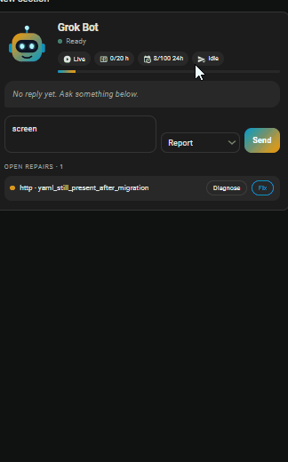
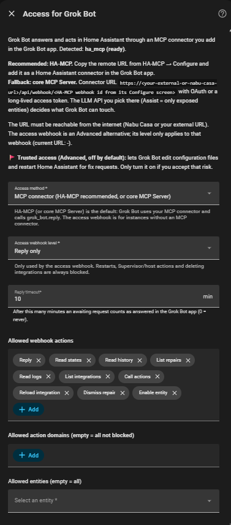
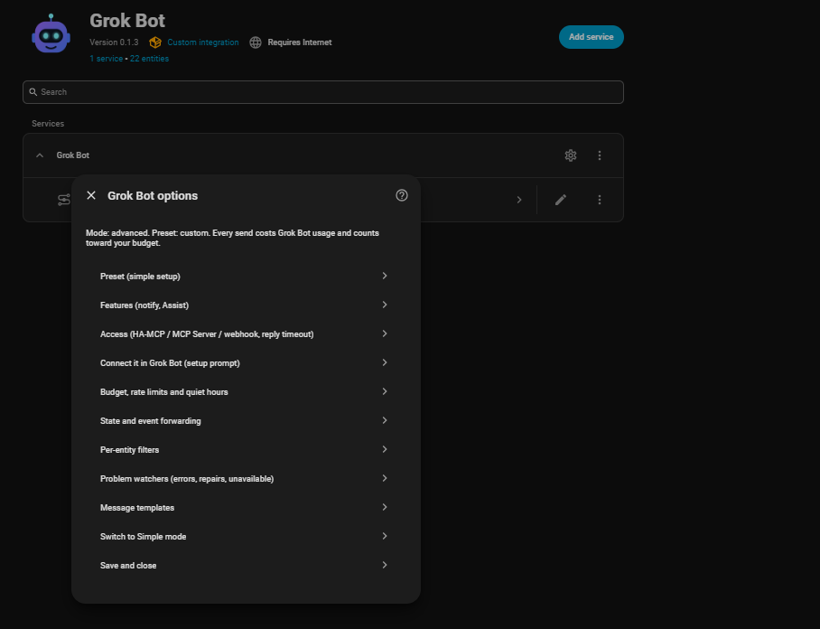
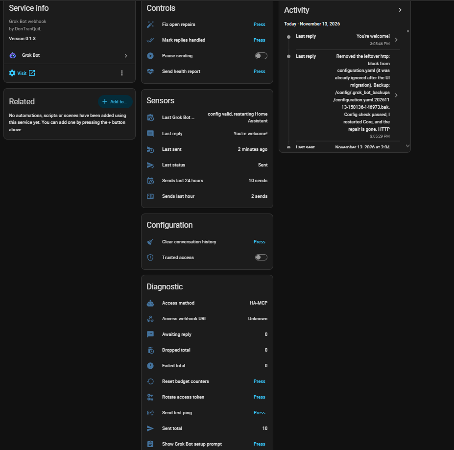
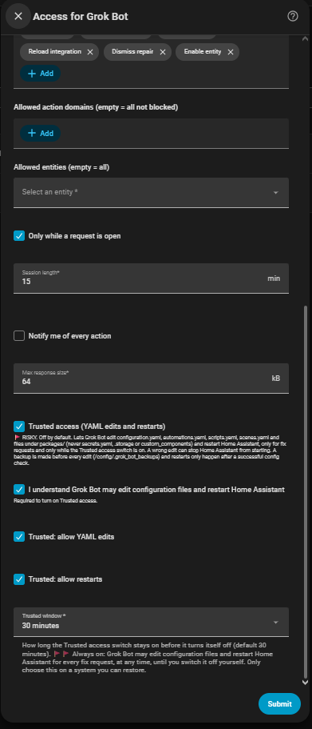

# Grok Bot for Home Assistant



[](https://my.home-assistant.io/redirect/marketplace_repository/?owner=DonTranQuiL&repository=grok-bot-ha&category=integration)
[](https://hacs.xyz/)
[](https://www.home-assistant.io/)
[](https://discord.gg/qaHPTTKHae)
[](https://liberapay.com/Malosaaa/donate)

Let Home Assistant talk to your **Grok Bot** assistant. Home Assistant sends questions, tasks, events and problems to a Grok Bot **routine webhook**. Grok Bot then looks into them and acts in Home Assistant through its own Home Assistant connector (**HA-MCP**), and answers back with the `grok_bot.reply` action, which updates the sensors and the dashboard card.

*The GIF above: the card shows an open `http` repair. Pressing **Fix** sends a fix request; Grok Bot backs up `configuration.yaml`, removes the leftover `http:` block with `grok_bot.edit_yaml`, runs a config check, restarts Home Assistant with `grok_bot.safe_restart` and reports back in the card.*

> **Every message Home Assistant sends to the webhook costs Grok Bot usage.** Nothing is sent automatically until you allow it, and a send budget (20 per hour, 100 per 24 hours by default) drops anything over the limit instead of queueing it.

> **Support is on GitHub only.** Questions, ideas and bug reports go to the [issues](https://github.com/DonTranQuiL/grok-bot-ha/issues). I don't answer on the Home Assistant forum.

## Contents

- [Requirements](#requirements)
- [How it works](#how-it-works)
- [Features](#features)
- [Installation](#installation)
- [Full setup guide (step by step)](#full-setup-guide-step-by-step)
- [The setup prompt](#the-setup-prompt)
- [Options, page by page](#options-page-by-page)
- [Entities](#entities)
- [Actions](#actions)
- [Events](#events)
- [Repairs raised by Grok Bot](#repairs-raised-by-grok-bot)
- [The dashboard card](#the-dashboard-card)
- [Trusted access (opt-in, risky)](#trusted-access-opt-in-risky)
- [Worked example: fixing the `http` YAML repair](#worked-example-fixing-the-http-yaml-repair)
- [Assist and notify](#assist-and-notify)
- [Blueprints](#blueprints)
- [Payload schema (what the webhook receives)](#payload-schema-what-the-webhook-receives)
- [Access webhook (Advanced alternative)](#access-webhook-advanced-alternative)
- [Troubleshooting and FAQ](#troubleshooting-and-faq)
- [Privacy and security](#privacy-and-security)
- [Limitations](#limitations)
- [Support](#support)

## Requirements

| What | Why |
| --- | --- |
| **A Grok Bot account** | Grok Bot does the thinking and the work. Every webhook run uses your Grok Bot usage. |
| **A Grok Bot routine with a webhook trigger** | This is the only way into Grok Bot: Home Assistant POSTs JSON to the routine's **Webhook URL** with its **Authorization header**. You create it in step 1 below (the setup prompt can also create or update it for you). |
| **HA-MCP** ([homeassistant-ai/ha-mcp](https://github.com/homeassistant-ai/ha-mcp)), strongly recommended | The connector Grok Bot uses to reach **back** into Home Assistant. Without an MCP connector Grok Bot receives your messages but **cannot** call `grok_bot.reply`, so the card and sensors never get an answer, and it cannot read states or fix anything. The integration is then one-way (send only). HA-MCP is the default and the integration detects it. |
| Core **MCP Server** (fallback) | Home Assistant's built-in [MCP Server](https://my.home-assistant.io/redirect/config_flow_start/?domain=mcp_server) works too (connector path `/api/mcp`, OAuth or a long-lived token). Its LLM API (Assist = only exposed entities) limits what Grok Bot can do. |
| **A Home Assistant URL reachable from the internet** | Grok Bot runs in the cloud and has to reach your HA-MCP URL: Nabu Casa, your own external URL (reverse proxy) or a Cloudflare tunnel. Set it under **Settings > System > Network**. |
| **Home Assistant 2026.1 or newer** | The **Marketplace** install needs **2026.11** or newer; older versions install through HACS or manually. |

## How it works

```text
Home Assistant ──(trigger, button, card, action)──▶ grok_bot ──HTTPS POST JSON──▶ Grok Bot routine webhook
      ▲                                                                                   │
      │                                                                                   ▼
      └──── grok_bot.reply / states / fixes ◀──── HA-MCP connector (your HA login) ◀── Grok Bot
```

1. Something happens: you ask in the card, press a button, call an action, or an opt-in watcher sees an error or repair.
2. The integration checks the pause switch, quiet hours and the budget, builds a JSON payload (with a `conversation_id`) and POSTs it to your routine webhook.
3. Grok Bot reads the payload, investigates through HA-MCP and answers with `grok_bot.reply` and the same `conversation_id`.
4. The reply updates *Last reply*, the card's conversation, fires `grok_bot_reply`, and is delivered to the request's `reply_to` (an `input_text`, a notify target or a persistent notification).

Replies are asynchronous: they take seconds to minutes, not milliseconds.

## Features

* ✅ **UI setup** with a test ping, reauthentication and reconfigure flows.
* ✅ **Simple mode** with presets for beginners: *Ask only*, *Errors only*, *Errors + repairs, diagnose*, or *Custom*.
* ✅ **Advanced mode** with every option: allowlists, per-entity filters, Jinja message templates, a per-trigger action mode, quiet hours, budgets, debounce, a payload size limit and an attribute toggle.
* ✅ **Actions:** `grok_bot.ask`, `send_event`, `diagnose`, `fix_issue`, `health_report`, `ping` (all return the delivery status), and `grok_bot.reply` for Grok Bot's answers.
* ✅ **Problem watchers** (opt-in): logged errors and warnings, repair issues, entities that stay unavailable, failed automations and scripts, and integration setup failures. Per watcher you choose whether Grok Bot only **reports**, **diagnoses**, or may **diagnose and fix**.
* ✅ **Budget guard:** hourly and 24-hour limits, a **Pause sending** switch, counter sensors and `grok_bot_dropped` events. Nothing is queued and nothing is retried automatically.
* ✅ **Replies update Home Assistant:** a *Last reply* sensor with recent history, a `grok_bot_reply` event, and delivery to an `input_text`, a notify entity or service, or a persistent notification.
* ✅ **Access through HA-MCP (recommended):** guided onboarding detects HA-MCP (then core MCP Server), says *Install HA-MCP first* when it's missing, and otherwise shows a ready-to-paste **setup prompt** that connects your Grok Bot.
* ✅ **Trusted access (opt-in, Advanced):** for repairs that need YAML edits or a restart. Backups before every edit, a config check before every restart, a window that switches itself off (30 min, 2 h, 24 h or *Always on*), a safe `grok_bot.edit_yaml` with automatic rollback, a restart that waits for Grok Bot's reply, and a notification for every action.
* ✅ **"Awaiting reply" never sticks:** a reply timeout (10 min) marks requests *Replied in Grok Bot app*, and a *Mark replies handled* button clears them at once. Awaiting conversations survive restarts.
* ✅ **Dashboard card** `custom:grok-bot-card`: an animated bot avatar (idle, thinking, success, error, paused, restarting), an ask box, the last reply, the recent conversation, budget chips, and Diagnose/Fix buttons for open repairs. Visual editor, dark and light theme, custom avatar.
* ✅ **Optional entities:** a notify entity (`notify.send_message` to Grok Bot) and an **Assist conversation agent**.
* ✅ **Blueprints:** threshold alert, nightly health report, and replies pushed to your phone.
* ✅ Diagnostics with every secret redacted, plus English and Dutch translations.

## Installation

### Method 1: Marketplace (Home Assistant 2026.11 and newer, recommended)

[](https://my.home-assistant.io/redirect/marketplace_repository/?owner=DonTranQuiL&repository=grok-bot-ha&category=integration)

1. In Home Assistant, go to **Settings > Marketplace** and search for **Grok Bot** (or use the button above).
2. Open it and select **Install**. The setup starts right away, no restart needed.

> **Not in the Marketplace catalog yet?** Until Grok Bot is accepted into the default list, it does not show up in the Marketplace search. Select **Add from link** in the upper-right corner of the Marketplace, enter `https://github.com/DonTranQuiL/grok-bot-ha`, select **Add**, then open Grok Bot and select **Install**.

### Method 2: HACS (Home Assistant before 2026.11)

1. In HACS, open the three-dot menu and select **Custom repositories**.
2. Add `https://github.com/DonTranQuiL/grok-bot-ha` with the category **Integration**.
3. Install **Grok Bot**, then restart Home Assistant.

### Method 3: Manual installation

1. Copy the `custom_components/grok_bot` folder (or unzip `grok_bot.zip` from the [latest release](https://github.com/DonTranQuiL/grok-bot-ha/releases/latest)) into `config/custom_components/`, so you end up with `config/custom_components/grok_bot/manifest.json`.
2. Restart Home Assistant.

---

## Full setup guide (step by step)

Do the steps in this order. Steps 1 and 2 happen before you add the integration, so setup can detect HA-MCP and show you the right prompt.

### Step 1: Create the webhook routine in the Grok Bot app

1. In the Grok Bot app, create a new **routine** (or open an existing one) and choose **Webhook** as its trigger.
2. The webhook trigger shows two values. Copy both:
   * the **Webhook URL** (starts with `https://`);
   * the **Authorization header** value (usually `Bearer …`).
3. You don't have to write the routine's instructions by hand: the setup prompt in step 4 tells Grok Bot to set up the routine's rules for you. (Want to write them yourself? See [the setup prompt](#the-setup-prompt), section 3.)

Keep both values private. Anyone with them can make your routine run and use your Grok Bot usage.

### Step 2: Install HA-MCP and create its server entry

1. Make sure Home Assistant has an internet-reachable URL (Nabu Casa, your own external URL or a Cloudflare tunnel) under **Settings > System > Network**.
2. [Install HA-MCP](https://my.home-assistant.io/redirect/hacs_repository/?owner=homeassistant-ai&repository=ha-mcp&category=integration) (`homeassistant-ai/ha-mcp`) from the Marketplace or HACS and restart Home Assistant.
3. [Add the HA-MCP integration](https://my.home-assistant.io/redirect/config_flow_start/?domain=ha_mcp_tools) and create its **server entry**.
4. Open **HA-MCP > Configure**. It shows the **remote URL** (`https://<your-external-url>/api/webhook/<HA-MCP webhook id>`). That is the connector URL Grok Bot uses. You normally don't need to copy it yourself: the setup prompt already contains it.

<details><summary>Prefer the core MCP Server instead?</summary>

[Set up MCP Server](https://my.home-assistant.io/redirect/config_flow_start/?domain=mcp_server), pick the LLM API (Assist = only exposed entities), and add `https://<your-external-or-nabu-casa-url>/api/mcp` in the Grok Bot app as a Home Assistant connector (OAuth or a long-lived access token). The *Connect it in Grok Bot* step only appears with HA-MCP, so with core MCP Server you add the connector and the routine rules yourself (copy section 3 of [the setup prompt](#the-setup-prompt)).
</details>

### Step 3: Install Grok Bot and add the integration

1. Install the integration (see [Installation](#installation)).
2. Go to **Settings > Devices & services > Add integration > Grok Bot**.
3. Fill in:
   | Field | What to enter |
   | --- | --- |
   | **Name** | Any name, e.g. *Grok Bot*. |
   | **Webhook URL** | The routine's `https://` Webhook URL from step 1. Only https is accepted. |
   | **Authorization header value** | Paste it exactly as shown (`Bearer …`). A pasted `Authorization:` prefix is removed automatically. It is stored as a secret and never logged. |
   | **Send a test ping** | Leave it on: it posts a `ping` to check URL and header (costs one Grok Bot run). A wrong header shows *The webhook rejected the Authorization header*; an unreachable URL shows *Could not reach the webhook*. |
4. **Pick a preset** (what may be sent automatically):
   | Preset | What gets sent automatically |
   | --- | --- |
   | **Ask only** (default) | Nothing. Only your own actions, buttons and the card. |
   | **Errors only** | Logged errors, failed automations or scripts, and integration setup failures (*report*). |
   | **Errors + repairs, diagnose** | The above plus new repair issues. Grok Bot investigates each one (*diagnose*). |
   | **Custom** | Opens Advanced mode with every option. |

### Step 4: Access, then *Connect it in Grok Bot*

Setup now shows the **Access** page. It detects what is installed: *Detected: **ha_mcp (ready)***, *mcp_server* or nothing.



* **HA-MCP not found?** The page is called **Install HA-MCP first** with links to install and add HA-MCP. You can finish setup anyway (Grok Bot stays send-only), and an *Install HA-MCP so Grok Bot can answer* repair stays open. After installing HA-MCP, open **Configure > Access** again: it re-detects HA-MCP and continues to the Connect page.
* Leave **Access method** on *MCP connector (HA-MCP recommended, or core MCP Server)* and **Reply timeout** on 10 minutes, then press **Submit**.

With HA-MCP installed, the next page is **Connect it in Grok Bot**. It shows the **setup prompt**, already filled in with your Home Assistant name, its HA-MCP remote URL and your routine webhook URL:

1. **Copy the whole prompt** from the code block.
2. **Paste it into a chat with your Grok Bot** and send it.
3. Grok Bot adds Home Assistant as a connector through HA-MCP and shows a **one-time connector sign-in card**. Open it: you log in on **your own Home Assistant login page** and allow access. Your password never reaches Grok Bot; it only gets an access token that you can revoke any time under **Profile > Security** in Home Assistant.
4. Grok Bot creates or updates the webhook routine with safe rules (respect `action_mode`, never delete things, always answer with `grok_bot.reply`, Trusted rules).
5. Grok Bot confirms by calling `grok_bot.reply` with **"Connected"**. That first reply clears the **Grok Bot not connected yet** repair, which stays open until then.
6. Press **Submit** to finish setup.

**Where to find the prompt again later:**
* **Configure > Connect it in Grok Bot (setup prompt)** in the options menu (only with HA-MCP installed);
* the **Show Grok Bot setup prompt** button on the device page: it opens a persistent notification (bell icon) with the prompt;
* the *Grok Bot not connected yet* repair tells you the same.

Paste it again after updating the integration to give Grok Bot the newest routine rules (0.1.4 added the restart-waits-for-reply rule).

### Step 5: Choose what gets sent

Simple mode (preset) is enough for most people. For more control open **Configure** and pick a preset or **Switch to Advanced mode** (see [Options, page by page](#options-page-by-page)). To stop all sending at once, turn on **Pause sending**.

### Step 6: Add the card

Edit a dashboard, select **Add card** and choose **Grok Bot** (or add `type: custom:grok-bot-card`). The card is loaded automatically by the integration; you don't need to add a resource. See [The dashboard card](#the-dashboard-card).

### Step 7: Test it

1. Press **Send test ping** on the device page. *Last status* becomes *Sent*, and *Sends last hour* goes up.
2. Ask something in the card (mode *Report*), for example *"Which lights are on?"*. The avatar shows *Thinking…*, and within seconds to a minute the answer appears in the card and in `sensor.grok_bot_last_reply`.
3. Or from a script:
   ```yaml
   action: grok_bot.ask
   data:
     message: "The solar tilt looks stuck, can you check it?"
     context_entities: [cover.solar_tilt]
     action_mode: diagnose
     reply_to: persistent_notification
   ```

No answer? See [Troubleshooting](#troubleshooting-and-faq).

## The setup prompt

Shown in the *Connect it in Grok Bot* step, under **Configure > Connect it in Grok Bot**, and by the **Show Grok Bot setup prompt** button. It is Dutch when Home Assistant's language is Dutch. It never contains your Authorization header or any token; the placeholders below are filled in with your own values.

<details><summary>English</summary>

```text
Hi Grok Bot, please connect my Home Assistant "<your HA name>" to you.

1. Connect it: add Home Assistant as a connector using HA-MCP (homeassistant-ai/ha-mcp). MCP URL: https://<your-external-or-nabu-casa-url>/api/webhook/<HA-MCP webhook id>
   (copy the exact remote URL from HA-MCP > Configure in Home Assistant if this one is a placeholder).
   Show me the one-time connector sign-in card: I log in on my own Home Assistant page, so my password never reaches you; the access token can be revoked any time in Home Assistant under Profile > Security.
2. Create or update a webhook routine for the Grok Bot Home Assistant integration. Its webhook URL is: <your Grok Bot routine webhook URL>
   Each POST carries a JSON payload with schema, type (ask, event, state, issue, log, health_report, ping, ...), message, conversation_id, action_mode, allow_fix, context and an access block.
3. Rules for that routine:
   - Respect action_mode: report = just summarise; diagnose = investigate read-only; fix = only when allow_fix is true, and only safe, reversible fixes (reload an integration, re-enable an entity, dismiss a fixed repair).
   - Never delete integrations, devices or entities. Never restart Home Assistant Core and never edit configuration files, unless the payload's access block has trusted: true:
     - allow_yaml_edit: true lets you edit configuration.yaml, automations.yaml, scripts.yaml, scenes.yaml or files under packages/ (never secrets.yaml, .storage or custom_components). Always call grok_bot.prepare_change with the file path first and keep the returned backup_path; if anything goes wrong call grok_bot.restore_backup with it.
     - Prefer grok_bot.edit_yaml (path + operation remove_key / set_key / replace_text): it makes the backup itself, validates the YAML, runs a configuration check and restores the backup automatically when the check fails. Use it for top-level keys such as http, homeassistant, frontend or lovelace that the HA-MCP file tools refuse.
     - allow_restart: true lets you restart, but only through grok_bot.safe_restart (it checks the configuration first and returns the errors instead of restarting when it is invalid). Pass the payload's conversation_id to grok_bot.safe_restart and send your grok_bot.reply right after it: the restart waits for that reply (at most 25 seconds), so the answer is never lost.
   - Always answer through the grok_bot.reply action on this Home Assistant (HA-MCP connector "<your HA name>") with the payload's conversation_id, so the integration's sensors update.
   - Stay quiet in our chat for routine successes; only message me when something failed or needs my decision.
4. Confirm it works: call grok_bot.reply with message "Connected" (no conversation_id needed).
```
</details>

<details><summary>Nederlands</summary>

```text
Hoi Grok Bot, koppel alsjeblieft mijn Home Assistant "<your HA name>" aan jou.

1. Koppelen: voeg Home Assistant toe als connector via HA-MCP (homeassistant-ai/ha-mcp). MCP-URL: https://<your-external-or-nabu-casa-url>/api/webhook/<HA-MCP webhook id>
   (kopieer de exacte externe URL uit HA-MCP > Configureren in Home Assistant als dit een voorbeeld is).
   Laat me de eenmalige aanmeldkaart van de connector zien: ik log in op de pagina van mijn eigen Home Assistant, dus mijn wachtwoord komt nooit bij jou; het toegangstoken kan ik altijd intrekken in Home Assistant onder Profiel > Beveiliging.
2. Maak of werk een webhook-routine bij voor de Grok Bot Home Assistant-integratie. De webhook-URL is: <your Grok Bot routine webhook URL>
   Elke POST bevat JSON met schema, type (ask, event, state, issue, log, health_report, ping, ...), message, conversation_id, action_mode, allow_fix, context en een access-blok.
3. Regels voor die routine:
   - Volg action_mode: report = alleen samenvatten; diagnose = alleen-lezen onderzoeken; fix = alleen als allow_fix true is, en alleen veilige, omkeerbare oplossingen (integratie herladen, entiteit weer inschakelen, opgeloste reparatie negeren).
   - Verwijder nooit integraties, apparaten of entiteiten. Herstart nooit Home Assistant Core en bewerk nooit configuratiebestanden, behalve als het access-blok trusted: true bevat:
     - allow_yaml_edit: true staat bewerken toe van configuration.yaml, automations.yaml, scripts.yaml, scenes.yaml of bestanden onder packages/ (nooit secrets.yaml, .storage of custom_components). Roep altijd eerst grok_bot.prepare_change aan met het bestandspad en bewaar het teruggegeven backup_path; gaat er iets mis, roep dan grok_bot.restore_backup aan met dat pad.
     - Gebruik bij voorkeur grok_bot.edit_yaml (pad + bewerking remove_key / set_key / replace_text): die maakt zelf de back-up, controleert de YAML, voert een configuratiecontrole uit en zet de back-up automatisch terug als die mislukt. Gebruik dit voor sleutels op het hoogste niveau zoals http, homeassistant, frontend of lovelace die de HA-MCP-bestandstools weigeren.
     - allow_restart: true staat herstarten toe, maar alleen via grok_bot.safe_restart (die controleert eerst de configuratie en geeft de fouten terug in plaats van te herstarten als die ongeldig is). Geef de conversation_id uit het bericht mee aan grok_bot.safe_restart en stuur direct daarna je grok_bot.reply: de herstart wacht op dat antwoord (maximaal 25 seconden), zodat het antwoord nooit verloren gaat.
   - Antwoord altijd via de actie grok_bot.reply op deze Home Assistant (HA-MCP-connector "<your HA name>") met de conversation_id uit het bericht, zodat de sensoren van de integratie bijwerken.
   - Blijf stil in onze chat bij routinematige successen; stuur me alleen een bericht als iets mislukt of mijn beslissing nodig is.
4. Bevestig dat het werkt: roep grok_bot.reply aan met het bericht "Connected" (zonder conversation_id).
```
</details>

## Options, page by page

Open **Settings > Devices & services > Grok Bot > Configure**. The first line shows the current mode and preset.



> **Every page saves as soon as you press Submit.** You can close the dialog afterwards; *Save and close* only closes it.

Simple mode shows *Preset*, *Features*, *Access*, *Connect it in Grok Bot* (with HA-MCP), *Budget*, *Switch to Advanced mode* and *Save and close*. Advanced mode adds *State and event forwarding*, *Per-entity filters*, *Problem watchers*, *Message templates* and the extra Access and Budget fields marked **(Advanced)** below.

<details open><summary><b>Preset (simple setup)</b></summary>

*Ask only*, *Errors only*, *Errors + repairs, diagnose* or *Custom* (see [step 3](#step-3-install-grok-bot-and-add-the-integration)). A preset sets the problem watchers; *Custom* switches to Advanced mode. Changing a watcher yourself sets the preset to *Custom*.
</details>

<details><summary><b>Features (notify, Assist)</b></summary>

| Field | Default | Meaning |
| --- | --- | --- |
| Notify entity (notify.send_message to Grok Bot) | off | Adds `notify.grok_bot`: anything sent to it goes to Grok Bot (counts toward the budget). |
| Assist conversation agent | off | Adds `conversation.grok_bot` for voice assistants. Assist answers right away that the message was sent; the real answer arrives later. |
| Attach entity attributes to context | on | Off sends only states, which keeps payloads small. |
</details>

<details><summary><b>Access (HA-MCP / MCP Server / webhook, reply timeout)</b></summary>

Re-detects HA-MCP / MCP Server every time you open it. The top shows the detected provider, the connector URL for core MCP Server and the access webhook URL.

| Field | Default | Meaning |
| --- | --- | --- |
| **Access method** | MCP connector | *MCP connector (HA-MCP recommended, or core MCP Server)*; *Access webhook of this integration (Advanced)* for instances without an MCP connector; *No access* (Grok Bot can't answer in HA). |
| **Access webhook level** | Reply only | Only used by the access webhook: *Reply only*, *Read* (states, history, logs, repairs), *Control* (call actions on allowed entities), *Fix* (also reload integrations, dismiss repairs, enable entities). Restarts, Supervisor/host actions and deleting integrations are always blocked. |
| **Reply timeout** | 10 min | After this many minutes an awaiting request counts as answered in the Grok Bot app (0 = never). |
| Allowed webhook actions **(Advanced)** | all | Which access webhook actions may be used: Reply, Read states, Read history, List repairs, Read logs, List integrations, Call actions, Reload integration, Dismiss repair, Enable entity. |
| Allowed action domains **(Advanced)** | empty = all not blocked | Domains `call_service` may use. |
| Allowed entities **(Advanced)** | empty = all | Entities the access webhook may touch. |
| Only while a request is open **(Advanced)** | on | Access webhook calls only work while a request is open. |
| Session length **(Advanced)** | 15 min | How long such a session stays open. |
| Notify me of every action **(Advanced)** | off | A persistent notification for every access webhook action. |
| Max response size **(Advanced)** | 64 kB | Limit for access webhook responses. |
| **Trusted access (YAML edits and restarts)** 🚩 **(Advanced)** | off | See [Trusted access](#trusted-access-opt-in-risky). |
| I understand Grok Bot may edit configuration files and restart Home Assistant **(Advanced)** | off | Required to turn Trusted access on (otherwise: *Tick the confirmation to turn on Trusted access*). Turning Trusted off clears it. |
| Trusted: allow YAML edits **(Advanced)** | on | Allows `edit_yaml`, `prepare_change`, `restore_backup` while Trusted is active. |
| Trusted: allow restarts **(Advanced)** | on | Allows `safe_restart` while Trusted is active. |
| Trusted window **(Advanced)** | 30 minutes | 30 minutes, 2 hours, 24 hours or *Always on (until I switch it off)* 🚩. |

With HA-MCP installed, *Submit* continues to the **Connect it in Grok Bot** page.
</details>

<details><summary><b>Connect it in Grok Bot (setup prompt)</b></summary>

Only with HA-MCP installed. Shows the [setup prompt](#the-setup-prompt) to paste into Grok Bot (see [step 4](#step-4-access-then-connect-it-in-grok-bot)).
</details>

<details><summary><b>Budget, rate limits and quiet hours</b></summary>

| Field | Default | Meaning |
| --- | --- | --- |
| Max sends per hour | 20 | Rolling hour. Can't be higher than the daily limit. |
| Max sends per 24 hours | 100 | Rolling 24 hours. |
| Minimum seconds between forwards of the same entity or event **(Advanced)** | 300 | Debounce for forwarding (drops show as *Dropped (cooldown)*). |
| Quiet hours (drop automatic sends) **(Advanced)** | off | Automatic sends between start and end are dropped; your own asks still go. |
| Quiet hours start / end **(Advanced)** | 23:00 / 07:00 | May wrap midnight. |
| Payload size limit **(Advanced)** | 16000 bytes | Too large payloads are shrunk (attributes first, then details, then the message), otherwise dropped. |

Budget rules: every POST counts (manual actions, buttons, the card, notify and Assist too). Over the limit a message is **dropped** (`grok_bot_dropped` event, *Dropped total*), never queued. Manual actions can set `bypass_budget: true` (still counted; the pause switch still applies). Nothing is retried automatically; after a 401/403 Home Assistant asks you to reauthenticate.
</details>

<details><summary><b>State and event forwarding (Advanced)</b></summary>

| Field | Meaning |
| --- | --- |
| Entities to forward | Only these entities' state changes are sent. Empty = nothing. |
| Action mode for state changes | report / diagnose / fix. |
| Ignore changes to unavailable/unknown | On by default. |
| Event types to forward | Type an event type and press Enter, e.g. `zha_event`. `state_changed`, `call_service`, registry/recorder/logbook/system-log events and every `grok_bot_*` event are blocked (loops and floods). |
| Action mode for events | report / diagnose / fix. |
</details>

<details><summary><b>Per-entity filters (Advanced)</b></summary>

Pick a forwarded entity (first add some under *State and event forwarding*), then set: *Only when the new state is one of …*, *Use this attribute instead of the state*, *Only when above* / *below* (these fire when the value **crosses into** the range, not on every change), *Minimum seconds between forwards*, or *Remove this filter*.
</details>

<details><summary><b>Problem watchers (errors, repairs, unavailable) (Advanced)</b></summary>

Every watcher is off until you enable it (or a preset does). Each has its own action mode (report / diagnose / fix).

| Section | Fields |
| --- | --- |
| Logged errors and warnings | Forward log records; minimum level (warning, error, critical); logger filter (all, only these, all except these) with logger names such as `homeassistant.components.zha`; group identical errors for N seconds (default 3600, the repeat count goes with the next one). Grok Bot's own log lines are never forwarded. |
| Repair issues | Forward new repair issues. |
| Unavailable entities | Entities to watch; unavailable or unknown for N minutes (default 15). |
| Failed automations and scripts | Forward automation and script errors. |
| Integration setup failures | Forward integrations that end in setup error or retry. |
</details>

<details><summary><b>Message templates (Advanced)</b></summary>

Optional Jinja templates for the `message` field. Empty = built-in text. Variables: state changes `entity_id`, `from_state`, `to_state`; events `event_type`, `event_data`; problems `kind`, `issue`.

```jinja
{{ entity_id }} went from {{ from_state.state }} to {{ to_state.state }}, please check.
```
</details>

<details><summary><b>Switch to Simple / Advanced mode, Save and close</b></summary>

Switching mode only changes which pages and fields you see; your settings are kept. *Save and close* closes the dialog (everything was already saved on Submit).
</details>

**Action modes:** `report` (just tell me), `diagnose` (investigate and reply, change nothing), `fix` (diagnose and try **safe, reversible** fixes such as reloading a config entry; the payload sets `allow_fix: true`).

**Reconfigure and reauthenticate:** *⋮ > Reconfigure* changes the webhook URL and header. When the webhook answers 401/403, a reauthentication flow asks for the current Authorization header.

## Entities



| Entity | Category | What it does / shows |
| --- | --- | --- |
| `button.grok_bot_fix_open_repairs` | Controls | Sends all open repairs as a `fix_issue` request (`action_mode: fix`). |
| `button.grok_bot_mark_replies_handled` | Controls | Clears *Awaiting reply* (answered in the Grok Bot app). |
| `switch.grok_bot_pause_sending` | Controls | Stops all sending while on. |
| `button.grok_bot_send_health_report` | Controls | Sends open repairs, failed integrations, unavailable entities and recent errors (`diagnose`). |
| `sensor.grok_bot_last_reply` | Sensor | Last answer (first 255 characters). Attributes: `message` (full), `title`, `conversation_id`, `received`, `data`, `history` (last 20 messages, in and out). |
| `sensor.grok_bot_last_status` | Sensor | *Idle, Sent, Failed, Authorization failed, Dropped (budget / paused / cooldown / quiet hours / too large), Replied in Grok Bot app, Restarting after the reply, Restarted, waiting for the result*. Attribute `last_error`. |
| `sensor.grok_bot_last_sent` | Sensor | Time of the last send. |
| `sensor.grok_bot_sends_last_hour` / `_sends_last_24_hours` | Sensor | Budget counters with `limit`, `remaining` (24 h also `paused`). |
| `sensor.grok_bot_last_grok_bot_action` | Sensor | Last audited action (access webhook and Trusted). Attributes `ok`, `time`, `audit` (last 25). |
| `button.grok_bot_clear_conversation_history` | Configuration | Empties the card's conversation (history, last reply, awaited replies). History otherwise survives restarts. Nothing is sent. |
| `switch.grok_bot_trusted_access` | Configuration | **Only exists after enabling *Trusted access* + the confirmation on the Access page and pressing Submit.** Opens the Trusted window. |
| `sensor.grok_bot_access_method` | Diagnostic | `ha_mcp`, `mcp_server`, `webhook` or `none` (what works right now), with the access block as attributes (incl. connector URL hint). |
| `sensor.grok_bot_access_webhook_url` | Diagnostic | Access webhook URL when that method is used (else unknown). Attributes `source`, `access_level`, `allowed_actions`. |
| `sensor.grok_bot_awaiting_reply` | Diagnostic | Number of conversations waiting for an answer. Attributes `restart_scheduled` (a `safe_restart` waits for a reply), `restarted_waiting` (HA restarted, result still to come), `conversations` (id, type, restarting, restarted). |
| `sensor.grok_bot_sent_total` / `_failed_total` / `_dropped_total` | Diagnostic | Lifetime counters. |
| `button.grok_bot_reset_budget_counters` | Diagnostic | Resets the hour/24 h counters. |
| `button.grok_bot_rotate_access_token` | Diagnostic | New access webhook token; the old one stops working at once. |
| `button.grok_bot_send_test_ping` | Diagnostic | Sends a `ping`. |
| `button.grok_bot_show_grok_bot_setup_prompt` | Diagnostic | Shows the setup prompt as a persistent notification. |
| `notify.grok_bot` | – | Only with *Notify entity* enabled. |
| `conversation.grok_bot` | – | Only with *Assist conversation agent* enabled. |

Entity ids may differ if you named the entry differently.

## Actions

Common fields for the sending actions: `context_entities` (their states are attached), `reply_to`, `conversation_id` (reuse to continue a conversation), `notify_user` (Grok Bot also messages you in its app), `bypass_budget`, `config_entry_id` (only with several entries). They all return the delivery status.

| Action | Fields | Response |
| --- | --- | --- |
| `grok_bot.ask` | `message`, `action_mode`, `data` + common | delivery status |
| `grok_bot.send_event` | `event_type`, `message`, `data`, `action_mode` + common | delivery status |
| `grok_bot.diagnose` | `message`, `issue_id`, `issue_domain` (looked up when empty), `target_config_entry_id` + common | delivery status |
| `grok_bot.fix_issue` | same as diagnose, with `allow_fix: true` | delivery status |
| `grok_bot.health_report` | `action_mode` + common | delivery status |
| `grok_bot.ping` | `bypass_budget`, `config_entry_id` | delivery status |
| `grok_bot.reply` | `message`, `conversation_id`, `title`, `reply_to`, `data`, `config_entry_id` (used by Grok Bot) | – |
| `grok_bot.rotate_token` | `config_entry_id` | – |
| `grok_bot.clear_history` | `config_entry_id` | `{"history", "awaiting"}` |
| `grok_bot.prepare_change` | `path` (Trusted + YAML edits, admin only) | `{"path", "backup_path"}` |
| `grok_bot.restore_backup` | `backup_path` (Trusted + YAML edits, admin only) | `{"path", "restored_from"}` |
| `grok_bot.edit_yaml` | `path`, `operation` (`remove_key` / `set_key` / `replace_text`), `key`, `value`, `find`, `replace`, `count` (Trusted + YAML edits, admin only) | `{"ok", "changed", "path", "backup_path", "errors", "restored", "restart_required"}` |
| `grok_bot.safe_restart` | `conversation_id` (optional) (Trusted + restarts, admin only) | `{"valid", "restarting", "errors", "delay", "waiting_for_reply"}` |

Delivery status: `{"status": "sent" | "failed" | "auth_failed" | "dropped_budget" | "dropped_paused" | "dropped_quiet_hours" | "dropped_too_large", "conversation_id": "…", "http_status": 200, "sends_last_hour": 3, "sends_last_24h": 27, "remaining_last_hour": 17, "remaining_last_24h": 73}`.

`reply_to` accepts an `input_text.*` entity (cut to its max length), a `notify.*` entity, a legacy `notify.<service>`, or `persistent_notification`. A reply can never be routed back to Grok Bot's own notify entity.

<details><summary>Examples</summary>

```yaml
# Ask and get the answer on your phone
action: grok_bot.ask
data:
  message: "Is the attic window closed?"
  context_entities: [binary_sensor.attic_window]
  reply_to: notify.mobile_app_my_phone
---
# Let Grok Bot investigate one repair (no changes)
action: grok_bot.diagnose
data:
  issue_domain: zha
  issue_id: radio_lost
---
# Custom event with data, diagnose mode
action: grok_bot.send_event
data:
  event_type: boiler_pressure_low
  message: "Boiler pressure dropped below 1 bar"
  data: {pressure: 0.8}
  action_mode: diagnose
---
# What Grok Bot calls to answer
action: grok_bot.reply
data:
  conversation_id: "8f3c…"
  title: "Solar tilt fixed"
  message: "The actuator lost its Zigbee route; I re-interviewed it."
---
# Trusted: remove a top-level key safely (backup + check + auto-restore)
action: grok_bot.edit_yaml
data:
  path: configuration.yaml
  operation: remove_key
  key: http
---
# Trusted: restart after the reply of this conversation
action: grok_bot.safe_restart
data:
  conversation_id: "8f3c…"
```
</details>

## Events

| Event | When |
| --- | --- |
| `grok_bot_sent` | A message was accepted by the webhook (`type`, `source`, `conversation_id`). |
| `grok_bot_failed` | The webhook was unreachable or returned an error (`error`). |
| `grok_bot_dropped` | Dropped. `reason` is `dropped_budget`, `dropped_paused`, `dropped_quiet_hours`, `dropped_cooldown` or `dropped_too_large`. |
| `grok_bot_reply` | Grok Bot answered (`message`, `title`, `conversation_id`, `reply_to`, `data`). |
| `grok_bot_action` | An audited access webhook or Trusted action (`type`, `ok`, `summary`). |

## Repairs raised by Grok Bot

| Repair | When | Clears |
| --- | --- | --- |
| *Install HA-MCP so Grok Bot can answer* | Access method is MCP but no MCP server is installed. | When HA-MCP or MCP Server is set up. |
| *Grok Bot not connected yet* | HA-MCP is installed but no `grok_bot.reply` arrived yet. | With Grok Bot's first reply ("Connected"). |
| *Grok Bot Trusted access is always on* | Trusted access is active with *Always on*. | When you switch Trusted off or pick a time window. |

## The dashboard card


`custom:grok-bot-card` is registered automatically. It shows:
* an **animated avatar** with a status line: *Ready*, *Thinking…*, *Replied*, *Problem*, *Paused*, *Restarting after the reply…*, *Restarted, waiting for the result…*;
* **chips**: Live/Paused (click to toggle **Pause sending**), sends this hour and per 24 h, the last status, and *N awaiting* (click = **Mark replies handled**), plus a 24 h budget bar;
* the **last reply** with its title and time;
* an **ask box** with a mode picker (Report, Diagnose, Diagnose + fix) and *Send*;
* the **recent conversation** (your questions and Grok Bot's answers, plus *Restart done* entries);
* **open repairs** with **Diagnose** and **Fix** buttons (send `grok_bot.diagnose` / `grok_bot.fix_issue` for that repair; listing repairs needs an admin user).

```yaml
type: custom:grok-bot-card
title: Grok Bot            # optional
avatar_url: /local/me.png  # optional: your own picture instead of the animated bot
config_entry_id: …         # optional, only with several Grok Bot entries
show_chips: true
show_ask: true
show_history: true
show_issues: true
max_history: 6             # 1-20
max_issues: 4              # 1-20
default_mode: report       # report | diagnose | fix
```

Everything is also in the visual editor. The card follows the dark or light theme and English or Dutch.

## Trusted access (opt-in, risky)

Some repairs can only be fixed by editing YAML and restarting, for example a leftover `http:` block. Over the normal paths Grok Bot never does that (and HA-MCP's file tools refuse top-level keys such as `http`, `homeassistant`, `frontend` and `lovelace`). **Trusted access** allows it, under strict rules.



### Turn it on

1. **Configure > Switch to Advanced mode**, then **Access**. Scroll down.
2. Tick **Trusted access (YAML edits and restarts)** 🚩 **and** *I understand Grok Bot may edit configuration files and restart Home Assistant* (required).
3. Choose **Trusted: allow YAML edits** and **Trusted: allow restarts** (both on by default), and the **Trusted window**: 30 minutes (default), 2 hours, 24 hours or **Always on** 🚩🚩.
4. Press **Submit**. The entry reloads and the switch **Trusted access** (`switch.grok_bot_trusted_access`) appears under *Configuration* on the device page. No switch? You did not tick both boxes, or you closed the dialog without Submit.
5. **Turn the switch on** when you want Grok Bot to work on such a repair. Only then is Trusted *active*.

### Timed window vs Always on

* A **timed window** (30 min / 2 h / 24 h) switches itself off when it ends, **and after every restart** of Home Assistant (so after a `safe_restart` it is off again: switch it on for the next job).
* **Always on** stays on, also across restarts, until you switch it off. While active it keeps the *Grok Bot Trusted access is always on* warning repair open. Only choose it on a system you can restore.

### What Grok Bot may and may not do

Only for **fix requests** (`action_mode: fix`, `allow_fix: true`, e.g. the **Fix** button or *Fix open repairs*) and only while the switch is on, the payload carries `access.trusted: true` with `allow_yaml_edit`, `allow_restart`, `trusted_until` and the service names. Then:

* **May edit:** `configuration.yaml`, `automations.yaml`, `scripts.yaml`, `scenes.yaml` and `*.yaml` under `packages/`.
* **Never:** `secrets.yaml`, `.storage`, `custom_components`, `.grok_bot_backups`, hidden files or anything outside `/config`.
* The four Trusted actions are **admin-only** and refuse to run unless Trusted is active (and the matching *allow* option is on).
* Every Trusted action (switch on/off, backup, edit, restore, restart, denials, *restart done*) goes to the *Last Grok Bot action* audit sensor, the `grok_bot_action` event and a persistent notification.

### The tools

| Action | What it does |
| --- | --- |
| `grok_bot.prepare_change` | Copies the file to `/config/.grok_bot_backups/<file>.<timestamp>.bak` and returns `backup_path` (the last 50 backups are remembered). |
| `grok_bot.edit_yaml` | Makes that backup itself, applies the edit **as text** (comments and other keys stay as they are), validates the YAML (`!secret`/`!include` allowed), runs a **full configuration check**, and **restores the backup automatically** when the check fails. Operations: `remove_key` (removes every top-level block of `key`, duplicates too), `set_key` (replaces or adds a top-level `key` with `value`), `replace_text` (`find` → `replace`, `count` 0 = all; for nested changes). Returns `restart_required: true` when something changed. |
| `grok_bot.restore_backup` | Puts a backup from `prepare_change`/`edit_yaml` back. |
| `grok_bot.safe_restart` | Runs the configuration check again and **only restarts when it is valid** (otherwise it returns the errors). |

### The restart waits for the reply

Grok Bot passes the payload's `conversation_id` to `safe_restart` and sends its `grok_bot.reply` right after. While that conversation still awaits its reply, the restart waits (at most **25 seconds**; *Last status* and the card show *Restarting after the reply*) and goes ahead **2 seconds after the reply has arrived**. Without a `conversation_id` it waits for any conversation that still awaits a reply; when nothing does, it restarts at once.

Awaiting conversations are kept in storage. If the reply only arrives after the restart, it still lands in the right conversation and goes to its `reply_to`. After the restart the history gets a *Restart done, Home Assistant is back.* entry, and until the result is in, the card shows *Restarted, waiting for the result*. Reloading the integration during the wait cancels the restart.

## Worked example: fixing the `http` YAML repair

This is what the GIF at the top shows. After Home Assistant moved the HTTP settings to the UI, an old `http:` block in `configuration.yaml` raises the repair **`http.yaml_still_present_after_migration`** (the YAML is ignored; the UI settings under **Settings > System > Network** are used).

1. Enable Trusted access with *allow YAML edits* and *allow restarts* (see above) and press Submit.
2. Turn on **Trusted access** on the device page.
3. In the card, press **Fix** next to the `http` repair (or press **Fix open repairs**).
4. Grok Bot receives a fix request with `access.trusted: true` and:
   1. checks the repair and the current UI network settings through HA-MCP;
   2. calls `grok_bot.edit_yaml` with `path: configuration.yaml`, `operation: remove_key`, `key: http` → backup `/config/.grok_bot_backups/configuration.yaml.<timestamp>.bak`, every `http:` block removed, YAML valid, config check passed;
   3. calls `grok_bot.safe_restart` with the `conversation_id`, then `grok_bot.reply`: *"Removed the leftover http: block … Backup: … Config check passed, restarting."*;
5. Home Assistant restarts 2 seconds after that reply. The card shows the answer and, after the restart, *Restart done, Home Assistant is back.* The repair is gone and the Trusted switch is off again (timed window).
6. Something wrong? Call `grok_bot.restore_backup` with the `backup_path` from the reply (or copy the `.bak` file back yourself) and restart.

Tip: compare the trusted proxies of the old `http:` block with **Settings > System > Network** before you let it go; the UI is what counts.

## Assist and notify

* **Assist:** enable *Assist conversation agent* under *Features*, then pick *Grok Bot* as the conversation agent of a voice assistant. Assist answers right away with *"Sent to Grok Bot. I'll answer shortly."* (Dutch: *"Doorgestuurd naar Grok Bot. Ik antwoord zo."*). The real answer arrives later in the reply sensor, the card and the `grok_bot_reply` event, with the same `conversation_id`.
* **Notify:** enable *Notify entity*, then `action: notify.send_message` with `entity_id: notify.grok_bot` sends the message to Grok Bot.

## Blueprints

[](https://my.home-assistant.io/redirect/blueprint_import/?blueprint_url=https%3A%2F%2Fgithub.com%2FDonTranQuiL%2Fgrok-bot-ha%2Fblob%2Fmain%2Fblueprints%2Fautomation%2Fgrok_bot%2Fask_on_threshold.yaml)

* `blueprints/automation/grok_bot/ask_on_threshold.yaml`: ask Grok Bot when a sensor stays above or below a value, with a cooldown.
* `blueprints/automation/grok_bot/nightly_health_report.yaml`: one health report per day.
* `blueprints/automation/grok_bot/reply_to_phone.yaml`: push every reply to the companion app (free, no Grok Bot usage).

## Payload schema (what the webhook receives)

<details><summary>Full payload</summary>

```json
{
  "schema": 1,
  "type": "ask | custom_event | notify | conversation | diagnose | fix_issue | health_report | ping | state_changed | event | log_error | automation_error | setup_error | setup_failed | repair_issue | entity_unavailable",
  "message": "Human-readable text (template output when configured)",
  "source": "service | assist | <entity_id> | <event_type> | <logger>",
  "context": [{"entity_id": "sensor.attic", "state": "31.2", "name": "Attic", "last_changed": "…", "attributes": {}}],
  "reply_to": "input_text.grok_answer",
  "conversation_id": "8f3c…",
  "notify_user": false,
  "action_mode": "report | diagnose | fix",
  "allow_fix": false,
  "data": {"…": "type-specific details: issue, event_data, logger, traceback, repeats_suppressed, …"},
  "timestamp": "2026-11-13T08:40:00+00:00",
  "ha_instance": {"name": "Home", "version": "2026.11.0", "integration_version": "0.1.4", "config_entry_id": "…", "time_zone": "Europe/Amsterdam"},
  "reply_with": {"service": "grok_bot.reply", "data": {"config_entry_id": "…", "conversation_id": "8f3c…", "message": "<your answer>"}},
  "access": {"method": "mcp | webhook | none", "configured_method": "mcp", "mcp_ready": true, "trusted": true, "allow_yaml_edit": true, "allow_restart": false, "trusted_until": "… | forever", "always_on": false, "mcp_provider": "ha_mcp | mcp_server | null", "connector_url_hint": "https://…/api/webhook/<HA-MCP webhook id>", "ha_instance": {"name": "Home", "external_url": "https://…", "config_entry_id": "…"}},
  "callback": {"protocol": 1, "url": "https://…/api/webhook/…", "token": "…", "token_header": "X-Grok-Bot-Token", "access_level": "reply", "allowed_actions": ["reply"], "expires": "…", "conversation_id": "8f3c…"},
  "truncated": true
}
```

`trusted`, `allow_yaml_edit`, `allow_restart`, `trusted_until`, `always_on` and the service names only appear for fix requests (`action_mode: fix`, `allow_fix: true`) while Trusted access is active. `access.method` is the path that works right now (`none` when the configured MCP server isn't installed or the access webhook has no external URL). `callback` is only present with the access webhook method. `truncated` only appears when the payload had to be shrunk to fit the size limit. The integration first drops attributes, then large detail fields, then shortens the message.

**Telling Grok Bot what to do.** Put this in the routine's instructions: *"Handle the Home Assistant payload. Respect `action_mode`: for `report`, only summarise; for `diagnose`, investigate with the Home Assistant connector without changing anything; for `fix`, only perform safe, reversible fixes (reload a config entry, retry, toggle back). Always answer by calling `grok_bot.reply` with the given `conversation_id`. Message me only when `notify_user` is true or something failed."*
</details>

## Access webhook (Advanced alternative)

<details><summary>For instances without an MCP connector</summary>

For an instance where no MCP connector is possible, set **Configure > Access > Access method** to *Access webhook*. Each payload then carries a `callback` block: Grok Bot POSTs `{"conversation_id": "…", "actions": [{"type": "reply", "message": "…"}, {"type": "get_states", "domains": ["light"]}]}` to `callback.url` with the `X-Grok-Bot-Token` header. The URL is a Nabu Casa cloudhook when available, otherwise your external URL.

| Level | Actions |
| --- | --- |
| Reply only (default) | `reply` |
| Read | + `get_states`, `get_history`, `list_repairs`, `get_logs`, `list_entries` |
| Control | + `call_service` (optionally limited to domains/entities) |
| Fix | + `reload_entry`, `ignore_repair`, `enable_entity` |

Restarting or stopping Home Assistant, Supervisor/host, shell and Python script actions, recorder purges, update installs and anything in `grok_bot` are always blocked. By default calls only work while a request is open (15 min). Every call is audited in *Last Grok Bot action* and a `grok_bot_action` event; **Rotate access token** invalidates the token immediately. The full protocol is in [docs/callback_protocol.md](docs/callback_protocol.md).

</details>

## Troubleshooting and FAQ

<details><summary><b>I asked something but no reply shows up in the card</b></summary>

* Check *Last status*: *Sent* means the webhook accepted it; *Failed*, *Authorization failed* or *Dropped (…)* explain why it never left (see below).
* Grok Bot can only answer in Home Assistant through its connector. Check *Access method* = `HA-MCP` (not `none`), and that the *Grok Bot not connected yet* repair is gone. If it's still there, send the [setup prompt](#the-setup-prompt) again and approve the sign-in card.
* Check the run in the Grok Bot app: did the routine run, and did it call `grok_bot.reply` with the `conversation_id`? The setup prompt's rules tell it to.
* Answers can take a minute. The card shows *Thinking…* for up to 3 minutes after a send.
* If the reply was posted to Grok Bot's chat instead, press **Mark replies handled**.
</details>

<details><summary><b>"Awaiting reply" stays above 0</b></summary>

It goes back down when Grok Bot calls `grok_bot.reply` with the `conversation_id`, when the **reply timeout** passes (Configure > Access, default 10 minutes, 0 = never; *Last status* then shows *Replied in Grok Bot app*), or when you press **Mark replies handled** (or click the *N awaiting* chip in the card). After a restart the timeout starts again.
</details>

<details><summary><b>The Trusted access switch is missing</b></summary>

It only exists when, in **Advanced mode > Access**, both *Trusted access* and *I understand …* are ticked and you pressed **Submit**. It sits under *Configuration* on the device page. After a restart a timed window is off again (the switch stays, just off).
</details>

<details><summary><b>Authorization failed / reauthentication</b></summary>

The routine's webhook answered 401/403. Home Assistant opens a reauthentication flow: paste the current Authorization header from the Grok Bot app. Changed the URL? Use *⋮ > Reconfigure*. **Rotate access token** is something else: it only renews the token of the optional access webhook.
</details>

<details><summary><b>Messages are dropped</b></summary>

* *Dropped (budget)*: the hour/24 h limit is used up. Wait, raise the limits under *Budget*, press **Reset budget counters**, or use `bypass_budget: true` for a manual action.
* *Dropped (paused)*: **Pause sending** is on.
* *Dropped (quiet hours)*: an automatic send during quiet hours.
* *Dropped (cooldown)*: the same entity/event was forwarded less than the minimum interval ago.
* *Dropped (too large)*: the payload didn't fit the size limit, even after shrinking.
</details>

<details><summary><b>Grok Bot can't reach Home Assistant</b></summary>

The HA-MCP URL must be reachable from the internet. Check **Settings > System > Network** (Nabu Casa, external URL or tunnel), open **HA-MCP > Configure** for the exact remote URL, and make sure it's the one in the setup prompt. *Access method* `none` means the configured connector isn't installed or has no external URL.
</details>

<details><summary><b>Clear the conversation in the card</b></summary>

Press **Clear conversation history** (device page, *Configuration*) or call `grok_bot.clear_history`. History, the last reply and awaited replies are emptied; nothing is sent. A restart does not clear it.
</details>

<details><summary><b>Revoke Grok Bot's access</b></summary>

* In Home Assistant: **Profile > Security**, delete the token of the Grok Bot connector (refresh tokens).
* In the Grok Bot app: remove the Home Assistant connector.
* Stop sending: **Pause sending**, or remove the integration.
* Trusted: switch **Trusted access** off, or untick it on the Access page.
</details>

<details><summary><b>Dutch / other languages</b></summary>

The integration, the card and the setup prompt are in English and Dutch; they follow Home Assistant's language (Dutch when HA is set to Dutch, English otherwise).
</details>

<details><summary><b>Diagnostics</b></summary>

*⋮ > Download diagnostics* on the integration gives the options, counters, status, conversation metadata (without message texts) and the access block, with the Authorization header, webhook URL, access webhook id/URL and token redacted. Attach it to an issue.
</details>

## Privacy and security

* **Your password never reaches Grok Bot.** Connecting a Home Assistant connector shows a one-time sign-in card. You log in on your own Home Assistant page, and Grok Bot only receives an access token. You can revoke that token any time in Home Assistant under **Profile → Security** (or by removing the connector in the Grok Bot app).
* The Authorization header value is stored in the config entry, sent only to the webhook URL, never logged, and redacted in diagnostics along with the webhook URL, the access webhook id/URL and its token.
* The setup prompt and payloads never contain the Authorization header, HA tokens or the HA-MCP webhook id (the prompt contains the HA-MCP URL so Grok Bot can connect).
* With HA-MCP or MCP Server, what Grok Bot can do is decided by that integration's settings, not by this one.
* Trusted access is off by default, needs an explicit confirmation, works only for fix requests while its switch is on, backs up every file before a change, rolls `edit_yaml` back when the config check fails and only restarts after a passing config check. *Always on* has to be chosen explicitly and keeps a warning repair open.
* Only https webhook URLs are accepted.
* The integration never forwards its own log lines or events, so it can't loop.
* Found a security problem? Please open an [issue](https://github.com/DonTranQuiL/grok-bot-ha/issues) without secrets, webhook URLs or tokens in it.

## Limitations

* There is no public Grok Bot API. Delivery is a webhook POST, and answers arrive asynchronously through `grok_bot.reply`.
* Grok Bot can only act in Home Assistant if its Home Assistant connector (HA-MCP or MCP Server) has access, and that needs a URL reachable from the internet.
* Because the transport is a private webhook, this integration is meant for the Marketplace and HACS, not Home Assistant core.

## Support

**Support only via [GitHub issues](https://github.com/DonTranQuiL/grok-bot-ha/issues). I don't answer on the forum.** Please include your Home Assistant and Grok Bot versions, what you did, *Last status*, and the diagnostics file (secrets are redacted). Never paste your webhook URL, Authorization header or tokens.

See the [CHANGELOG](CHANGELOG.md) for what changed per version.
